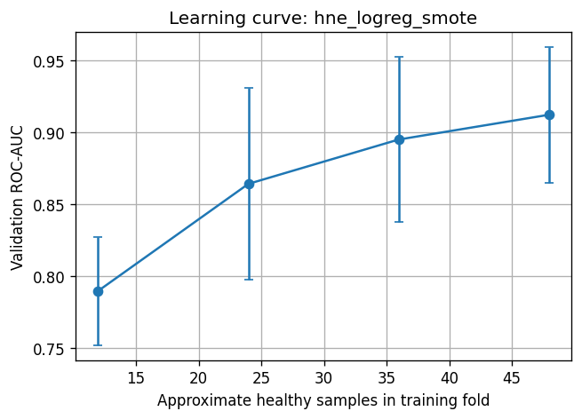
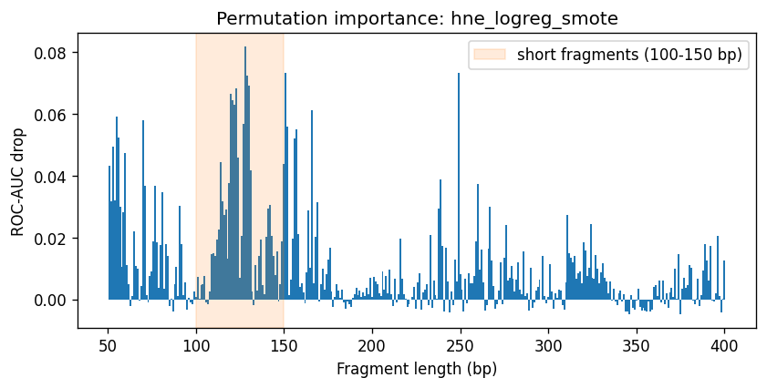
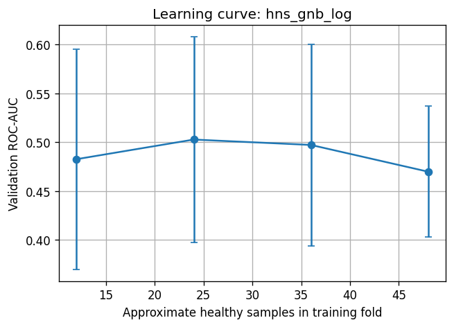
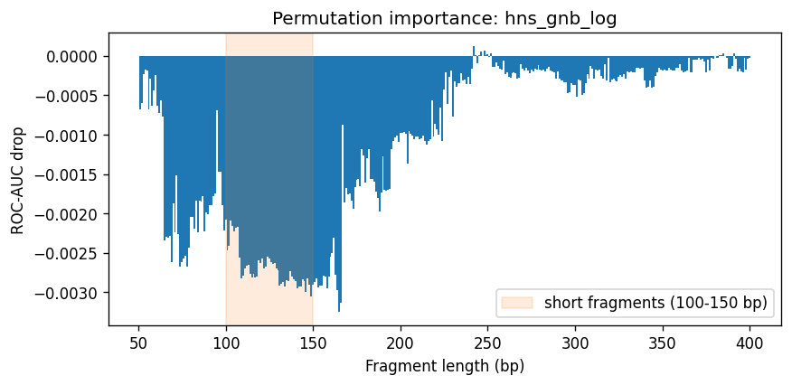
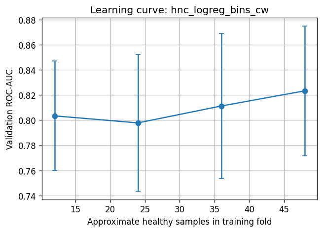
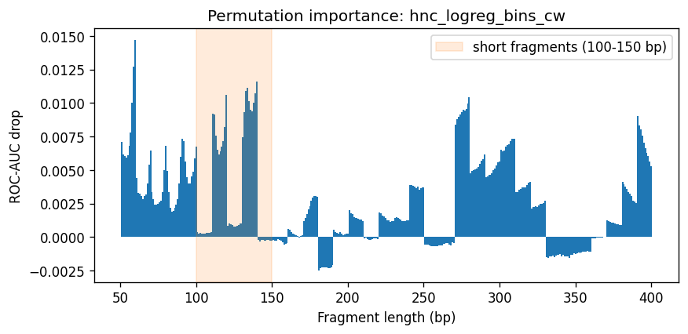

# Analysis

Generated by `python -m cancer_detection analysis`. Uses training data only.

## hne_logreg_smote

### Learning curve: hne_logreg_smote

Default hyperparameters; validation ROC-AUC over the outer CV folds.

| Training samples | ≈ Healthy samples | Validation ROC-AUC |
|---|---|---|
| 168 | 12 | 0.790 ± 0.038 |
| 336 | 24 | 0.864 ± 0.067 |
| 504 | 36 | 0.895 ± 0.057 |
| 672 | 48 | 0.912 ± 0.047 |

### Permutation importance: hne_logreg_smote

Mean drop in validation ROC-AUC when one fragment length is shuffled (default hyperparameters).

| Fragment length | ROC-AUC drop |
|---|---|
| 128 bp | 0.0819 |
| 249 bp | 0.0735 |
| 151 bp | 0.0734 |
| 129 bp | 0.0724 |
| 130 bp | 0.0691 |
| 123 bp | 0.0684 |
| 120 bp | 0.0666 |
| 121 bp | 0.0644 |
| 122 bp | 0.0630 |
| 166 bp | 0.0613 |
| 55 bp | 0.0591 |
| 70 bp | 0.0579 |
| 127 bp | 0.0568 |
| 152 bp | 0.0560 |
| 157 bp | 0.0549 |

## hns_gnb_log

### Learning curve: hns_gnb_log

Default hyperparameters; validation ROC-AUC over the outer CV folds.

| Training samples | ≈ Healthy samples | Validation ROC-AUC |
|---|---|---|
| 110 | 12 | 0.483 ± 0.113 |
| 220 | 24 | 0.503 ± 0.105 |
| 330 | 36 | 0.497 ± 0.103 |
| 440 | 48 | 0.470 ± 0.067 |

### Permutation importance: hns_gnb_log

Mean drop in validation ROC-AUC when one fragment length is shuffled (default hyperparameters).

| Fragment length | ROC-AUC drop |
|---|---|
| 242 bp | 0.0001 |
| 248 bp | 0.0001 |
| 246 bp | 0.0001 |
| 252 bp | 0.0000 |
| 385 bp | 0.0000 |
| 391 bp | 0.0000 |
| 250 bp | 0.0000 |
| 243 bp | 0.0000 |
| 245 bp | 0.0000 |
| 249 bp | 0.0000 |
| 383 bp | 0.0000 |
| 384 bp | 0.0000 |
| 247 bp | -0.0000 |
| 380 bp | -0.0000 |
| 386 bp | -0.0000 |

## hnc_logreg_bins_cw

### Learning curve: hnc_logreg_bins_cw

Default hyperparameters; validation ROC-AUC over the outer CV folds.

| Training samples | ≈ Healthy samples | Validation ROC-AUC |
|---|---|---|
| 438 | 12 | 0.803 ± 0.044 |
| 877 | 24 | 0.798 ± 0.054 |
| 1315 | 36 | 0.811 ± 0.058 |
| 1754 | 48 | 0.823 ± 0.052 |

### Permutation importance: hnc_logreg_bins_cw

Mean drop in validation ROC-AUC when one fragment length is shuffled (default hyperparameters).

| Fragment length | ROC-AUC drop |
|---|---|
| 60 bp | 0.0147 |
| 59 bp | 0.0127 |
| 140 bp | 0.0116 |
| 134 bp | 0.0111 |
| 133 bp | 0.0109 |
| 139 bp | 0.0107 |
| 120 bp | 0.0106 |
| 280 bp | 0.0104 |
| 135 bp | 0.0101 |
| 138 bp | 0.0100 |
| 58 bp | 0.0100 |
| 279 bp | 0.0100 |
| 278 bp | 0.0095 |
| 276 bp | 0.0095 |
| 136 bp | 0.0095 |

